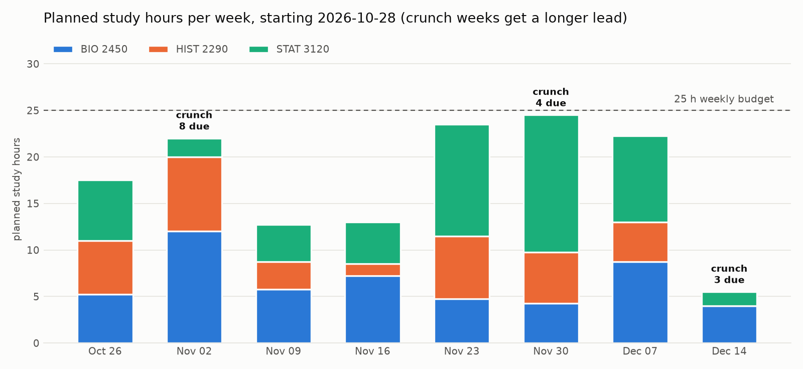
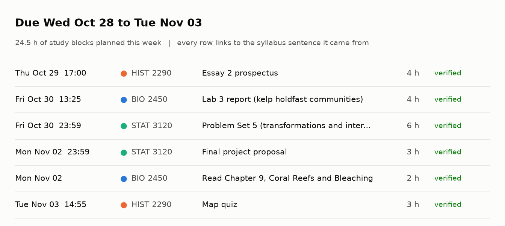

# Termplan

**Syllabi in. Every deadline out, checked against the sentence it came from, plus a calendar
file and a study plan that gets you ahead of crunch weeks.**

Built for the Nebius x NVIDIA Global AI Hackathon, Best Apps and Agents track. Termplan runs on
NVIDIA Nemotron served by Nebius Token Factory.



## The problem

At the start of every term a student gets four or five syllabi, each with its own format: one
lists real dates, one says "Week 10, Wednesday", one buries the essay deadline in a paragraph and
says the museum assignment is "TBA". Copying all of that into a calendar takes an evening, and
the clashes (two midterms on back-to-back days, an essay due the same week) only show up when
it is too late to work ahead.

Language models are good at reading messy syllabi and bad at being trusted with dates. Termplan
is built around that: the model does the reading, and the app checks every claim it makes.

## What it does

1. **Paste or upload syllabi** (PDF or text, up to 8 courses at once).
2. **A Nemotron agent extracts every graded deadline, exam, quiz, lab, project milestone and
   reading** into a strict JSON schema: title, kind, ISO date, time, grade weight, estimated hours
   with a one-line rationale, and the **exact source quote**.
3. **Every item is checked** before it is shown:
   - schema validation with pydantic, item by item, so one bad field does not discard the rest;
   - grounding: the source quote must appear verbatim in the syllabus (after normalizing
     whitespace, quotes, dashes and PDF hyphenation);
   - calendar sanity: the date must fall inside the term (catches wrong-year and week-arithmetic slips).
   Anything that fails goes back to the model with the exact errors, and the model repairs its own
   output (up to 3 attempts). Items that still fail the quote check are kept but marked
   "check by hand", never silently dropped. Undated items ("TBA") are listed separately.
4. **Cross-course checks**: same-day exams, back-to-back exams, 3+ graded deadlines within
   72 hours, and crunch weeks (more work due than your weekly study budget, or 3+ major items).
5. **Outputs**:
   - a downloadable **.ics calendar** (timed events for exams and timed deadlines, all-day events
     otherwise, reminders 1-2 days ahead, the source quote in every event description; optional
     daily study blocks);
   - a **week-by-week study plan** that spreads each item's hours over a lead window before its
     deadline within your daily capacity, and **starts crunch-week items earlier** so the work lands
     before the crunch; anything that cannot fit is flagged with the exact shortfall;
   - a **"next 7 days" view**: what is due and which study blocks to do.
6. **Coach notes**: a second Nemotron call reads the computed plan (not the raw syllabi) and writes
   a headline and 3-5 concrete tips that name real items and dates.



## How Nemotron and Token Factory are used

| What | Where |
|---|---|
| Endpoint | `https://api.tokenfactory.nebius.com/v1/` (OpenAI-compatible), from the [Token Factory quickstart](https://docs.tokenfactory.nebius.com/quickstart). Set with `NEBIUS_BASE_URL`. |
| Default model | `nvidia/Nemotron-3_5-Lightning`. Set with `TERMPLAN_MODEL`. |
| Client | The official `openai` Python SDK pointed at Token Factory ([termplan/llm.py](termplan/llm.py)). |
| Structured output | `response_format={"type": "json_schema", ...}` with the pydantic schema, falling back to `{"type": "json_object"}` and then plain prompting if a model rejects a mode (the working mode is remembered per model). The schema is always in the prompt too, as the [Structured output & JSON guide](https://docs.tokenfactory.nebius.com/ai-models-inference/json) recommends. |
| Reasoning output | `<think>` blocks are stripped before parsing; a reply cut off by the token limit (`finish_reason == "length"`) triggers a repair with a doubled `max_tokens`. |
| Reliability | 429 and 5xx responses are retried with exponential backoff; every call is logged with model, mode, finish reason, latency and token count. |
| Calls per plan | One extraction call per syllabus (more only when a repair is needed), run in parallel, plus one coach call. |

**Where the model IDs come from.** The Token Factory docs page
[Model Deprecations: November 2026](https://docs.tokenfactory.nebius.com/model-deprecations-november-2026)
lists `nvidia/NVIDIA-Nemotron-3-Nano-30B-A3B` and `nvidia/nemotron-3-super-120b-a12b` as leaving
Serverless on **November 9, 2026**, with `nvidia/Nemotron-3_5-Lightning` (text) and
`nvidia/Nemotron-3.5-Super-VL` (vision-language) as their replacements. Termplan defaults to
`nvidia/Nemotron-3_5-Lightning` so the hosted demo keeps working after that date. The model
catalog itself needs a login, so run `scripts/check_models.py` with your key to list the NVIDIA
models your account can call and to make one test JSON call; if a larger Nemotron model (for
example a Nemotron 3 Ultra ID) is listed, put it in `TERMPLAN_MODEL` or `TERMPLAN_COACH_MODEL`.

**Why Token Factory fits.** Syllabus extraction is many short, independent, schema-bound calls at
the start of a term. A serverless OpenAI-compatible endpoint means no GPU to run, per-token cost,
parallel calls per course, and swapping between Nemotron sizes by changing one environment
variable.

## Quick start

```bash
python3 -m venv .venv
.venv/bin/pip install -r requirements-dev.txt
cp .env.example .env            # then paste your Token Factory key into NEBIUS_API_KEY
.venv/bin/python scripts/check_models.py      # lists NVIDIA models, makes one test call
.venv/bin/uvicorn termplan.app:app --port 8000
# open http://127.0.0.1:8000 and click "Load 3 sample syllabi", then "Build my plan"
```

No key yet? Run fully offline against the built-in stub (no model calls, scripted replies that
include broken JSON to show the repair loop):

```bash
TERMPLAN_STUB=1 .venv/bin/uvicorn termplan.app:app --port 8000
```

### Configuration

| Variable | Default | Meaning |
|---|---|---|
| `NEBIUS_API_KEY` | (none) | Token Factory API key. Required unless `TERMPLAN_STUB=1`. |
| `NEBIUS_BASE_URL` | `https://api.tokenfactory.nebius.com/v1/` | OpenAI-compatible endpoint. |
| `TERMPLAN_MODEL` | `nvidia/Nemotron-3_5-Lightning` | Extraction model. |
| `TERMPLAN_COACH_MODEL` | same as `TERMPLAN_MODEL` | Model for the coach notes. |
| `TERMPLAN_STUB` | `0` | `1` = offline stub, no network. |
| `TERMPLAN_MAX_ATTEMPTS` | `3` | Extraction attempts per syllabus (first try + repairs). |
| `TERMPLAN_RATE_LIMIT` | `30` | Plans per client IP per hour (protects credits on a public demo). |
| `TERMPLAN_MAX_CONCURRENT` | `3` | Plans processed at once. |

### API

| Method | Path | Body |
|---|---|---|
| `GET` | `/api/health` | Mode, model ID, endpoint host, whether a key is set. |
| `GET` | `/api/samples` | The three sample syllabi. |
| `POST` | `/api/plan` | JSON: `{syllabi: [{name, text}], term_start, term_end, weekly_hours, today, front_load}` |
| `POST` | `/api/plan/upload` | multipart: `files` (PDF/TXT) + `texts` (JSON list) + the same fields |
| `POST` | `/api/ics` | `{items, plan, include_study_blocks}` -> `text/calendar` |

## Tests and the end-to-end run

```bash
.venv/bin/python -m pytest -q          # 66 tests
.venv/bin/python scripts/e2e.py        # full app vs. the local stub, writes docs/
.venv/bin/python scripts/render_docs.py
```

The tests cover the schema, the repair loop (broken JSON, bad fields, paraphrased quotes,
wrong-year dates, truncated replies, `json_schema` rejected -> `json_object` fallback), quote
matching on PDF text, conflict detection, the planner (capacity, shortfalls, front-loading),
ICS output (CRLF, escaping, 75-octet folding, all-day vs. timed) and the HTTP API, all against an
OpenAI-compatible stub ([termplan/stub.py](termplan/stub.py)) driven through the real `openai` SDK.

`scripts/e2e.py` uploads the three samples (one as a PDF) to the running app and saves:
[docs/sample-termplan.ics](docs/sample-termplan.ics),
[docs/sample-termplan-with-study.ics](docs/sample-termplan-with-study.ics),
[docs/sample-plan.md](docs/sample-plan.md) and [docs/e2e/](docs/e2e/) (raw result and run log).

## Deploy (Hugging Face Spaces)

I host the demo on a **Hugging Face Space with the Docker SDK**: the free CPU tier runs this app
comfortably (it does no local inference; Nemotron runs on Token Factory), the key is stored as a
Space secret, there is no credit card step, and judges get a stable `*.hf.space` URL. Render's free
tier would also work, but it spins down after 15 minutes idle and cold starts take close to a
minute, which is a poor first impression for a judge clicking the link.

1. Create a Space: SDK **Docker**, template **Blank**, hardware **CPU basic**.
2. Settings -> Variables and secrets: add secret `NEBIUS_API_KEY` (and optionally variable `TERMPLAN_MODEL`).
3. One command: `bash deploy/deploy_hf_space.sh <hf-username>/termplan`

The Space README with the required front matter (`sdk: docker`, `app_port: 7860`) lives in
[deploy/hf-space/README.md](deploy/hf-space/README.md). The same Dockerfile runs anywhere that
sets `$PORT` (Render, Fly, Cloud Run): `docker build -t termplan . && docker run -p 7860:7860 -e NEBIUS_API_KEY=... termplan`.

## Tech stack

- **Model**: NVIDIA Nemotron (`nvidia/Nemotron-3_5-Lightning` by default) on Nebius Token Factory
- **Backend**: Python 3.11, FastAPI, pydantic v2, `openai` SDK, pypdf
- **Frontend**: one HTML file with vanilla JS and CSS, no build step, light and dark mode
- **Calendar**: hand-written RFC 5545 export (no dependency)
- **Testing**: pytest, an OpenAI-compatible stub server, FastAPI TestClient
- **Docs images**: matplotlib

## Project layout

```
termplan/
  agent.py      extraction agent: prompt, validate, ground, repair loop; coach notes
  llm.py        Token Factory client: structured-output fallback, retries, logging
  schema.py     the strict item schema (pydantic)
  textutil.py   quote normalization and matching, JSON payload parsing
  conflicts.py  same-day / back-to-back exams, pile-ups, crunch weeks
  planner.py    week-by-week study plan with front-loading
  ics.py        .ics export
  pdftext.py    PDF and text reading
  service.py    the end-to-end pipeline
  app.py        FastAPI app
  stub.py       offline OpenAI-compatible stub
  static/index.html
examples/       three fictional syllabi (+ one as PDF)
scripts/        check_models.py, e2e.py, render_docs.py, build_stubdata.py, make_sample_pdf.py
deploy/         Hugging Face Space README and deploy script
tests/
```

## Limits

- Scanned PDFs without a text layer are rejected with a clear message (paste the text instead).
- Hours are estimates; the study plan treats every day as equal capacity.
- Times in the calendar are floating local times (they show at the stated clock time in any
  calendar app), which is what a syllabus means.

## License

MIT. See [LICENSE](LICENSE).
